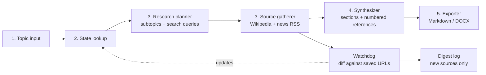

# ResearchOS

**A small, readable agentic research pipeline: plan a topic, gather sources, write a cited report, export it, and watch the topic for new sources.**


ResearchOS takes a topic such as `EV battery recycling market`, asks DeepSeek Flash to break it into 3 to 5 subtopics, fetches evidence for each from Wikipedia and Google News RSS, and has the model write a report in which every claim carries an inline citation like `[1]` or `[2][5]`. You can download the result as Markdown or DOCX. A separate watchdog script re-checks a topic and logs only the sources it has not seen before.

It began as a four-week internship project on agentic AI. It is deliberately small: each stage is one Python file with plain inputs and outputs, so you can read the whole system in an afternoon and extend it without a framework.

---

## What is real and what is not

Honest scope matters more than buzzwords, so here is exactly what this repository does.

| Capability | Status |
|---|---|
| Topic planning with an LLM (DeepSeek Flash, OpenAI-compatible API) | Implemented |
| Sources: Wikipedia REST API and Google News RSS (`feedparser`) | Implemented |
| Cited synthesis; citation numbers assigned by code | Implemented |
| Markdown and DOCX export | Implemented |
| Streamlit dashboard (Research and Export tabs) | Implemented |
| Watchdog with saved state and a digest log | Implemented |
| Model Context Protocol (MCP) | **Not used.** Tools are plain Python functions. Listed as a possible extension in `AGENTS.md`. |
| Learning loop (the agent improving from past runs) | **Not implemented.** The only persistent memory is the watchdog's list of already-seen URLs and its digest log. A proposal is in `AGENTS.md`. |

---

## How it works

1. **Input.** You enter a topic in the Streamlit app, or give one to the watchdog on the command line.
2. **State lookup.** The app keeps its results in `st.session_state` so they survive Streamlit reruns. The watchdog loads the URLs it has already seen for that topic.
3. **Tool execution.** The planner calls the model to produce subtopics and search queries. The gatherer then queries Wikipedia and news RSS for each one.
4. **Synthesis.** The model writes an introduction and one section per subtopic from the gathered sources only. References are numbered by code.
5. **Output.** The report is shown in the app and can be exported. The watchdog instead writes a digest entry of new sources and updates its saved URLs.



---

## Quickstart

You need Python 3.10 or newer, Git, and a DeepSeek API key.

### 1. Clone the project

```powershell
git clone https://github.com/uzainmohid/researchos.git
cd researchos
```

### 2. Create a virtual environment

Windows PowerShell:

```powershell
python -m venv venv
.\venv\Scripts\Activate.ps1
```

If PowerShell refuses to run the activation script, run this once in the same window, then try again:

```powershell
Set-ExecutionPolicy -Scope Process -ExecutionPolicy Bypass
```

macOS or Linux:

```bash
python3 -m venv venv
source venv/bin/activate
```

### 3. Install dependencies

```bash
pip install -r requirements.txt
```

### 4. Add your API key

Copy the template, then open the new `.env` file and paste your key after the `=`.

Windows:

```powershell
Copy-Item .env.example .env
notepad .env
```

macOS or Linux:

```bash
cp .env.example .env
```

The file needs one line:

```
DEEPSEEK_API_KEY=your_key_here
```

`.env` is listed in `.gitignore`, so it will not be committed. Always start the app from the project folder, because `config.py` looks for `.env` in the current directory. Never paste a key into code, an issue, or a chat.

### 5. First run

```bash
streamlit run app.py
```

Streamlit prints a local address (usually `http://localhost:8501`). Open it, type a topic, and click **Run research pipeline**.

If the app shows `DEEPSEEK_API_KEY not found`, the `.env` file is missing, empty, or not in the folder you started the app from.

---

## Walkthrough: what you will see

This describes the app's real behaviour. The plan and report depend on your topic and on what the sources return on the day, so no output is hard-coded here.

**Input.** In the **Research** tab, enter a topic (the field suggests `EV battery recycling market`) and click **Run research pipeline**.

**Progress.** The app shows three steps as they finish:

```
Step 1: Research Planner - decomposing topic into subtopics...   N subtopics planned
Step 2: Source Gatherer  - fetching Wikipedia + news RSS...      N sources gathered
Step 3: Synthesizer      - writing the report with citations...  Report written (N sections, N references)
```

**Plan.** Each subtopic is listed with its search query:

```
1. <subtopic> - search: <search query>
```

**Sources.** Each gathered source is an expandable block labelled `[subtopic] source_type: title`, with the first 500 characters of its content and its URL. `source_type` is `wikipedia` or `news_rss`. Use this to check what the model was given.

**Report.** An introduction, one section per subtopic with inline `[n]` citations, and a reference list:

```
[1] wikipedia: [<article title>](<url>)
[2] news_rss: [<headline>](<url>)
```

**Export.** In the **Export** tab, download the same report as Markdown or DOCX, with a Markdown preview below.

### Watchdog

The watchdog re-plans and re-gathers sources for a topic, compares the URLs with the ones it saved last time, and logs only the new ones.

```bash
python topic_watchdog.py check "EV battery recycling market"
python topic_watchdog.py digest
```

Typical console messages:

```
Checking topic: <topic>
Digest: N new source(s) found for '<topic>'.
No new sources for '<topic>' since last check.
```

The first check of any topic reports everything as new, because nothing has been saved yet. The watchdog was tested with three simulated daily checks that reported 2 new sources, then 1, then 0, which confirms that already-seen sources are filtered out.

To run it daily on Windows, create a Task Scheduler task that runs `venv\Scripts\python.exe topic_watchdog.py check "<your topic>"` with the project folder as the start location. On macOS or Linux, use `cron`.

State is stored in `watchdog_state.json` and `digest_log.json` in the project folder. Both are git-ignored.

---

## Project layout

```
researchos/
  app.py                 Streamlit dashboard and pipeline orchestration
  config.py              Loads .env, exposes DeepSeek settings
  research_planner.py    Topic -> subtopics + search queries
  source_gatherer.py     Wikipedia + news RSS retrieval
  synthesizer.py         Cited report writer
  exporter.py            Markdown and DOCX export
  topic_watchdog.py      Re-check a topic and log new sources
  requirements.txt
  .env.example
```

The full specification, including tests to add and an audit checklist, is in [`BUILD_SPEC.md`](BUILD_SPEC.md).

> **Naming warning.** Do not name a script `watchdog.py`. Streamlit imports the third-party `watchdog` package, and a local file with that name shadows it and crashes the app with `ImportError: cannot import name 'events' from 'watchdog'`. This is why the script is called `topic_watchdog.py`.

---

## Documentation for agents and contributors

| File | Purpose |
|---|---|
| [`SKILL.md`](SKILL.md) | Reusable skill specification: when to run the pipeline, inputs, tool contracts, memory rules, checks and error recovery |
| [`AGENTS.md`](AGENTS.md) | Roles, handoff contracts, guardrails, and how to extend the project with Claude Code |
| [`BUILD_SPEC.md`](BUILD_SPEC.md) | Folder tree, script specs, `.env.example`, `.gitignore`, and audit checklist |

---

## Origin: the Hermes Agent front-end

The first project in this series was a Telegram assistant built on the Hermes Agent CLI (Nous Research) with Gemini as its model. Two lessons from it carried over:

- A platform-specific prompt override (`platform_hints.telegram` in Hermes's `config.yaml`) is what makes a gateway follow a strict reply format. Hermes snapshots the system prompt at the start of a session, so run `/new` after every prompt edit.
- Facts should come from a fetched page, not from the model's memory.

ResearchOS itself does not call Hermes. It is a separate Python application that talks to the DeepSeek API directly.

---

## Limitations

- It depends on free or low-cost APIs whose limits and model names change.
- Retrieval takes the single best Wikipedia match and up to three news items per query, so a source can be on topic but not the best one. Read the source list.
- The model writes the report and chooses which `[n]` to cite. The code guarantees the reference list is accurate, not that every citation sits on the right sentence. Check important claims against the URLs.
- If planning or synthesis fails, the app falls back to a single generic subtopic or a raw listing of source excerpts, and says so.
- It runs locally for one user and has no authentication or deployment setup.
- No accuracy benchmark has been run, so no accuracy figures are claimed.

## Contributing

Issues and pull requests are welcome. Read `AGENTS.md` first; it lists the guardrails every change must keep.


## Contributing / Issues and PRs are welcome!

## License / Released under the MIT License.

MIT. See `LICENSE`.
